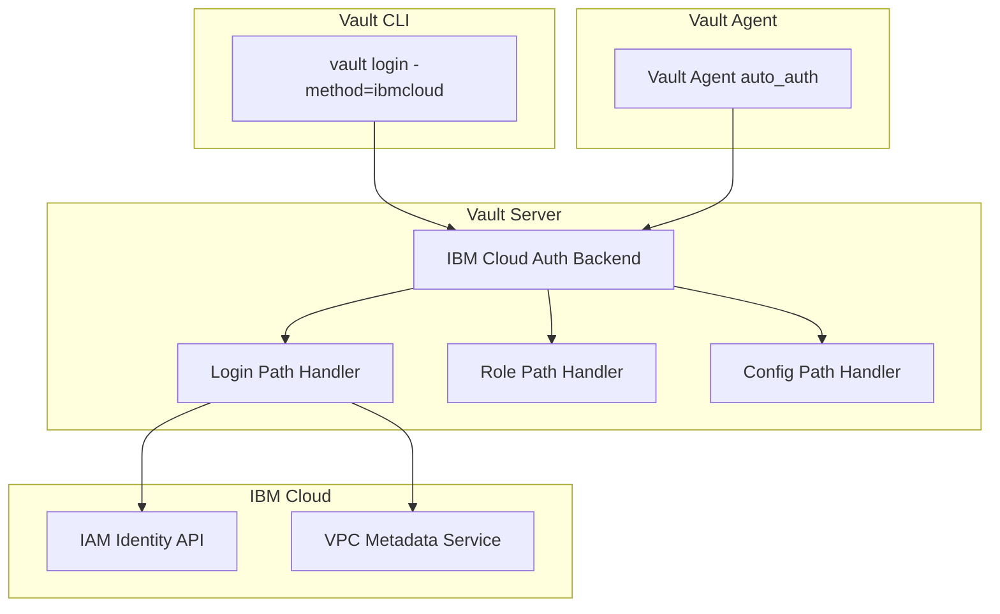
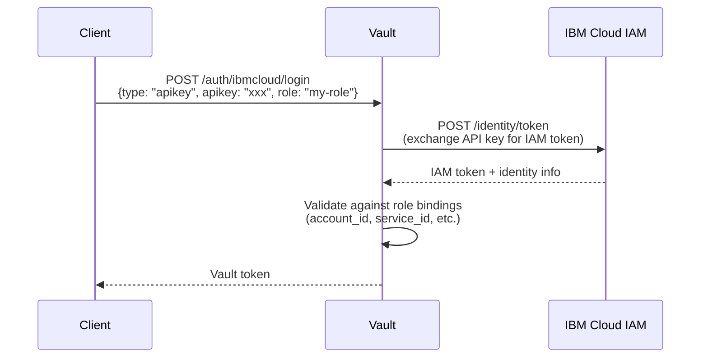
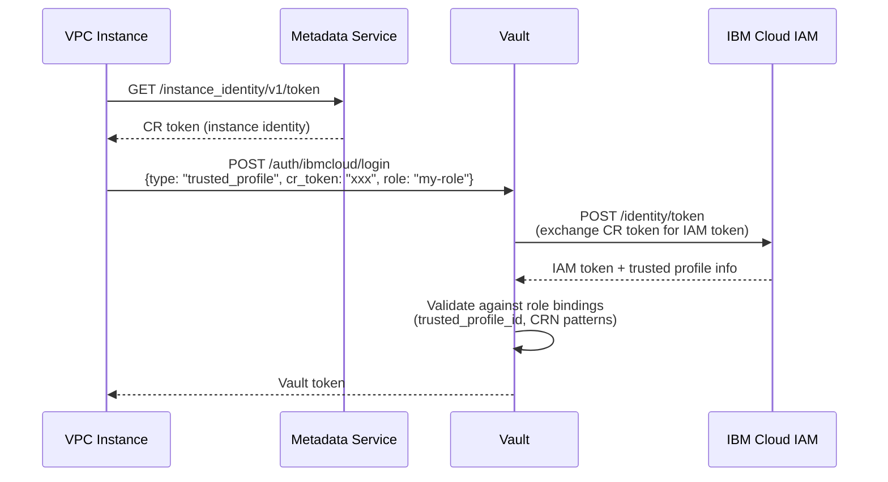

# IBM Cloud IAM Authentication Implementation Plan

## Overview

This document outlines the implementation plan for adding IBM Cloud IAM authentication support to HashiCorp Vault. The implementation will support both:
1. **API Key authentication** - Using IBM Cloud API keys
2. **Trusted Profile authentication** - Using IBM Cloud Trusted Profiles with compute resource tokens

The implementation follows Vault's existing authentication patterns, particularly the AWS auth method as a reference.

## Architecture

### High-Level Components



### Authentication Flow - API Key



### Authentication Flow - Trusted Profile



## Implementation Structure

### Directory Structure

```
builtin/credential/ibmcloud/
├── backend.go              # Backend factory and struct
├── backend_test.go         # Backend tests
├── path_login.go           # Login endpoint implementation
├── path_login_test.go      # Login tests
├── path_role.go            # Role CRUD operations
├── path_role_test.go       # Role tests
├── path_config.go          # Configuration endpoint
├── path_config_test.go     # Config tests
├── cli.go                  # CLI handler for vault login
├── cli_test.go             # CLI tests
└── client.go               # IBM Cloud IAM client wrapper

command/agentproxyshared/auth/ibmcloud/
├── ibmcloud.go             # Agent auto-auth implementation
└── ibmcloud_test.go        # Agent tests
```

## Detailed Component Specifications

### 1. Backend Structure (`backend.go`)

```go
type backend struct {
    *framework.Backend
    
    // Lock for configuration changes
    configMutex sync.RWMutex
    
    // Lock for role changes
    roleMutex sync.RWMutex
    
    // IBM Cloud IAM client
    iamClient *IBMCloudIAMClient
}

type IBMCloudIAMClient struct {
    // IAM endpoint URL
    iamEndpoint string
    
    // Metadata service endpoint
    metadataEndpoint string
    
    // HTTP client
    httpClient *http.Client
}
```

**Key Methods:**
- `Factory(ctx, conf)` - Creates and initializes the backend
- `Backend(conf)` - Constructs the backend with paths
- `invalidate(ctx, key)` - Handles configuration invalidation

### 2. Configuration (`path_config.go`)

**Endpoint:** `auth/ibmcloud/config`

**Configuration Fields:**
- `iam_endpoint` (string, optional) - IAM API endpoint URL (default: https://iam.cloud.ibm.com)
- `metadata_endpoint` (string, optional) - VPC metadata service endpoint (default: http://169.254.169.254)
- `iam_client_timeout` (duration, optional) - Timeout for IAM API calls (default: 30s)

**Operations:**
- `POST/PUT` - Configure IBM Cloud settings
- `GET` - Read current configuration
- `DELETE` - Reset to defaults

### 3. Role Management (`path_role.go`)

**Endpoint:** `auth/ibmcloud/role/:name`

**Role Fields:**

**Common Fields:**
- `type` (string, required) - Either "apikey" or "trusted_profile"
- `token_ttl` (duration) - Token TTL
- `token_max_ttl` (duration) - Maximum token TTL
- `token_policies` ([]string) - Policies to attach
- `token_bound_cidrs` ([]string) - CIDR blocks for token binding
- `token_explicit_max_ttl` (duration) - Explicit max TTL
- `token_no_default_policy` (bool) - Don't attach default policy
- `token_num_uses` (int) - Number of times token can be used
- `token_period` (duration) - Token renewal period
- `token_type` (string) - Token type (service, batch, default)

**API Key Type Fields:**
- `bound_account_id` (string, required) - IBM Cloud account ID
- `bound_service_ids` ([]string, optional) - List of allowed service IDs
- `bound_user_ids` ([]string, optional) - List of allowed user IDs
- `bound_access_group_ids` ([]string, optional) - List of allowed IBM Cloud IAM access group IDs

**Trusted Profile Type Fields:**
- `bound_trusted_profile_id` (string, required) - Trusted profile ID
- `bound_compute_resource_crn` ([]string, optional) - CRN patterns for compute resources
- `bound_compute_resource_type` ([]string, optional) - Resource types (e.g., "vsi", "iks")

**Operations:**
- `POST/PUT` - Create/update role
- `GET` - Read role
- `DELETE` - Delete role
- `LIST` - List all roles

### 4. Login Endpoint (`path_login.go`)

**Endpoint:** `auth/ibmcloud/login`

**Request Fields:**
- `role` (string, required) - Role name to authenticate against
- `type` (string, required) - "apikey" or "trusted_profile"

**For API Key Type:**
- `apikey` (string, required) - IBM Cloud API key

**For Trusted Profile Type:**
- `cr_token` (string, optional) - Compute resource token (if not provided, auto-fetch from metadata service)
- `trusted_profile_id` (string, optional) - Override trusted profile ID

**Authentication Logic:**

1. **Validate role exists and matches type**
2. **Obtain IAM token:**
   - API Key: Exchange API key for IAM token via IAM Identity API
   - Trusted Profile: Exchange CR token for IAM token (auto-fetch CR token if not provided)
3. **Extract identity information from IAM token**
4. **Validate against role bindings:**
   - API Key: Check account_id, service_id, user_id
   - Trusted Profile: Check trusted_profile_id, compute resource CRN
5. **Generate Vault token with configured policies**

### 5. CLI Handler (`cli.go`)

**Interface:** Implements `LoginHandler` interface

```go
type CLIHandler struct{}

func (h *CLIHandler) Auth(c *api.Client, m map[string]string) (*api.Secret, error)
func (h *CLIHandler) Help() string
```

**Supported Parameters:**
- `mount` - Mount path (default: "ibmcloud")
- `role` - Role name
- `type` - "apikey" or "trusted_profile"
- `apikey` - API key (for apikey type)
- `cr_token` - CR token (for trusted_profile type, optional)
- `trusted_profile_id` - Trusted profile ID (optional)

**Usage Examples:**
```bash
# API Key authentication
vault login -method=ibmcloud role=my-role type=apikey apikey=xxx

# Trusted Profile with auto-detection
vault login -method=ibmcloud role=my-role type=trusted_profile

# Trusted Profile with manual CR token
vault login -method=ibmcloud role=my-role type=trusted_profile cr_token=xxx
```

### 6. Vault Agent Auto-Auth (`command/agentproxyshared/auth/ibmcloud/ibmcloud.go`)

**Interface:** Implements `AuthMethod` interface

```go
type ibmcloudMethod struct {
    logger              hclog.Logger
    mountPath           string
    role                string
    authType            string // "apikey" or "trusted_profile"
    
    // For API key type
    apiKey              string
    
    // For trusted profile type
    crToken             string
    trustedProfileID    string
    metadataEndpoint    string
    
    // Credential refresh
    credLock            sync.Mutex
    credsFound          chan struct{}
    stopCh              chan struct{}
}

func NewIBMCloudAuthMethod(conf *auth.AuthConfig) (auth.AuthMethod, error)
func (a *ibmcloudMethod) Authenticate(ctx context.Context, client *api.Client) (string, http.Header, map[string]interface{}, error)
func (a *ibmcloudMethod) NewCreds() chan struct{}
func (a *ibmcloudMethod) CredSuccess()
func (a *ibmcloudMethod) Shutdown()
```

**Configuration Parameters:**
- `type` (required) - "apikey" or "trusted_profile"
- `role` (required) - Role name
- `apikey` (required for apikey type) - API key
- `cr_token` (optional for trusted_profile) - CR token
- `trusted_profile_id` (optional) - Trusted profile ID
- `metadata_endpoint` (optional) - Metadata service endpoint
- `credential_poll_interval` (optional) - Polling interval for credential refresh (default: 60s)

**Agent Configuration Example:**
```hcl
auto_auth {
  method {
    type = "ibmcloud"
    
    config = {
      role = "my-role"
      type = "trusted_profile"
      # CR token auto-fetched from metadata service
    }
  }
  
  sink {
    type = "file"
    config = {
      path = "/tmp/vault-token"
    }
  }
}
```

## IBM Cloud SDK Integration

### Dependencies

Add to `go.mod`:
```go
require (
    github.com/IBM/go-sdk-core/v5 v5.x.x
    github.com/IBM/platform-services-go-sdk v0.x.x
)
```

### Key SDK Components

1. **VpcInstanceAuthenticator** - For Trusted Profile authentication
   - Automatically fetches CR token from metadata service
   - Exchanges CR token for IAM token

2. **IamAuthenticator** - For API Key authentication
   - Exchanges API key for IAM token

3. **IAM Identity Service Client** - For token validation and identity lookup

### Client Implementation (`client.go`)

```go
type IBMCloudIAMClient struct {
    iamEndpoint      string
    metadataEndpoint string
    httpClient       *http.Client
}

// AuthenticateWithAPIKey exchanges an API key for an IAM token
func (c *IBMCloudIAMClient) AuthenticateWithAPIKey(ctx context.Context, apiKey string) (*IAMTokenResponse, error)

// AuthenticateWithCRToken exchanges a CR token for an IAM token
func (c *IBMCloudIAMClient) AuthenticateWithCRToken(ctx context.Context, crToken, trustedProfileID string) (*IAMTokenResponse, error)

// FetchCRToken retrieves CR token from VPC metadata service
func (c *IBMCloudIAMClient) FetchCRToken(ctx context.Context) (string, error)

// ValidateToken validates an IAM token and returns identity information
func (c *IBMCloudIAMClient) ValidateToken(ctx context.Context, token string) (*IdentityInfo, error)
```

## Testing Strategy

### Unit Tests

1. **Backend Tests** (`backend_test.go`)
   - Backend initialization
   - Path registration
   - Configuration management

2. **Login Tests** (`path_login_test.go`)
   - API key authentication flow
   - Trusted profile authentication flow
   - Role validation
   - Error handling

3. **Role Tests** (`path_role_test.go`)
   - Role CRUD operations
   - Role validation
   - Type-specific field validation

4. **Config Tests** (`path_config_test.go`)
   - Configuration CRUD
   - Default values
   - Validation

5. **CLI Tests** (`cli_test.go`)
   - Parameter parsing
   - Help text
   - Authentication flow

6. **Agent Tests** (`ibmcloud_test.go`)
   - Method initialization
   - Credential refresh
   - Authentication flow

### Integration Tests

1. **End-to-End Tests** (`builtin/credential/ibmcloud/ibmcloud_end_to_end_test.go`)
   - Full authentication flow with mock IBM Cloud IAM
   - Token lifecycle
   - Role binding validation

2. **Agent Integration Tests** (`command/agent/ibmcloud_end_to_end_test.go`)
   - Agent auto-auth with mock metadata service
   - Credential refresh
   - Token renewal

### Mock Services

Create mock implementations for testing:
- Mock IAM Identity API
- Mock VPC Metadata Service
- Mock token validation

## Implementation Phases

### Phase 1: Core Backend (Tasks 1-6)
- Research IBM Cloud IAM flows
- Create backend structure
- Implement configuration
- Implement role management
- Implement login endpoint
- Add IBM Cloud client wrapper

### Phase 2: CLI Integration (Task 7)
- Implement CLI handler
- Add help text
- Test CLI authentication

### Phase 3: Agent Integration (Tasks 8-10)
- Implement Agent auto-auth method
- Register in helpers
- Register CLI handler
- Test Agent authentication

### Phase 4: Testing (Tasks 11-13)
- Add unit tests
- Add integration tests
- Add end-to-end tests

### Phase 5: Documentation (Tasks 14-16)
- CLI documentation
- Agent configuration documentation
- Example configurations

## Security Considerations

1. **Credential Handling**
   - API keys should never be logged
   - CR tokens should be treated as sensitive
   - Use secure storage for cached credentials

2. **Token Validation**
   - Always validate IAM tokens with IBM Cloud
   - Check token expiration
   - Verify token claims match role bindings

3. **Network Security**
   - Use HTTPS for IAM API calls
   - Validate TLS certificates
   - Support custom CA certificates

4. **Role Binding**
   - Enforce strict matching of identity attributes
   - Support wildcards carefully (with proper validation)
   - Log all authentication attempts

## Configuration Examples

### Backend Configuration

```bash
# Configure IBM Cloud auth backend
vault write auth/ibmcloud/config \
    iam_endpoint="https://iam.cloud.ibm.com" \
    metadata_endpoint="http://169.254.169.254"
```

### Role Configuration - API Key

```bash
# Create role for API key authentication
vault write auth/ibmcloud/role/my-apikey-role \
    type=apikey \
    bound_account_id="abc123" \
    bound_service_ids="ServiceId-xxx,ServiceId-yyy" \
    token_policies="default,my-policy" \
    token_ttl=1h \
    token_max_ttl=24h
```

### Role Configuration - Trusted Profile

```bash
# Create role for trusted profile authentication
vault write auth/ibmcloud/role/my-profile-role \
    type=trusted_profile \
    bound_trusted_profile_id="Profile-xxx" \
    bound_compute_resource_crn="crn:v1:bluemix:public:is:us-south:a/abc123::instance:*" \
    token_policies="default,compute-policy" \
    token_ttl=1h \
    token_max_ttl=24h
```

### Vault Agent Configuration - API Key

```hcl
auto_auth {
  method {
    type = "ibmcloud"
    
    config = {
      role   = "my-apikey-role"
      type   = "apikey"
      apikey = "your-api-key-here"
    }
  }
  
  sink {
    type = "file"
    config = {
      path = "/tmp/vault-token"
    }
  }
}
```

### Vault Agent Configuration - Trusted Profile

```hcl
auto_auth {
  method {
    type = "ibmcloud"
    
    config = {
      role = "my-profile-role"
      type = "trusted_profile"
      # CR token will be auto-fetched from metadata service
      credential_poll_interval = 60
    }
  }
  
  sink {
    type = "file"
    config = {
      path = "/tmp/vault-token"
    }
  }
}
```

## API Reference

### Login API

**Endpoint:** `POST /auth/ibmcloud/login`

**API Key Authentication:**
```json
{
  "role": "my-apikey-role",
  "type": "apikey",
  "apikey": "your-api-key"
}
```

**Trusted Profile Authentication:**
```json
{
  "role": "my-profile-role",
  "type": "trusted_profile",
  "cr_token": "optional-cr-token"
}
```

**Response:**
```json
{
  "auth": {
    "client_token": "hvs.xxx",
    "accessor": "xxx",
    "policies": ["default", "my-policy"],
    "token_policies": ["default", "my-policy"],
    "metadata": {
      "account_id": "abc123",
      "service_id": "ServiceId-xxx",
      "auth_type": "apikey"
    },
    "lease_duration": 3600,
    "renewable": true
  }
}
```

## References

- [Vault Auth Methods](https://developer.hashicorp.com/vault/docs/auth)
- [Vault Agent Auto-Auth](https://developer.hashicorp.com/vault/docs/agent-and-proxy/autoauth)
- [IBM Cloud IAM Identity API](https://cloud.ibm.com/apidocs/iam-identity-token-api)
- [IBM Cloud VPC Metadata Service](https://cloud.ibm.com/docs/vpc?topic=vpc-imd-about)
- [IBM Cloud Trusted Profiles](https://cloud.ibm.com/docs/account?topic=account-trusted-profile-iam-token)
- [IBM Go SDK Core](https://github.com/IBM/go-sdk-core)