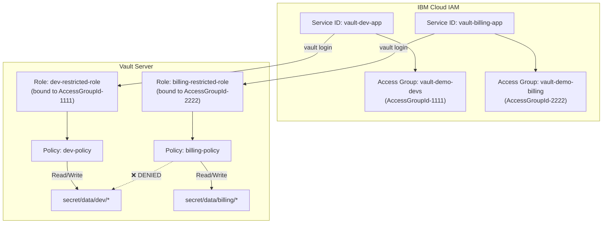

# IBM Cloud Auth Method: Align with AWS Where Beneficial

## Top-Level Overview

**Goal:** Make the `ibmcloud` auth method behave more like the `aws` auth method in three areas:
1. Credentials: clients exchange their long-lived credential locally and send only a short-lived signed IAM JWT to Vault.
2. Client and agent correctness: the CLI help matches behavior, and the agent auto-auth is registered and validated like every other method.
3. Config path: bring the `auth/ibmcloud/config` path closer to AWS `config/client` conventions.

**Decisions already confirmed with the user**
- `auth/ibmcloud/login` is replaced with a token-only contract. The server accepts only an IAM JWT in a `token` field. `apikey`, `cr_token` and `trusted_profile_id` are removed from the login path. This is a breaking change and is acceptable because the method is unreleased.
- The server must verify the JWT both **offline against IBM's JWKS** (signature, expiry, issuer) and **online via IAM introspect** (active flag and identity claims).
- The server never fetches a CR token. The current server-side fetch hits the Vault server's own metadata service, not the caller's, so it is removed entirely.
- Both the CLI handler (`vault login -method=ibmcloud`) and the Agent auto-auth method accept `apikey` / `cr_token` in their own config, exchange it with IBM IAM locally, and send only the resulting JWT to Vault.
- Caching was discussed and then dropped. It is not part of this plan.

**Key facts from research**
- IBM IAM has no SigV4-style pre-signed request. A signed RS256 JWT is the closest equivalent. It is a bearer token valid for up to about 60 minutes, so it is not non-replayable like SigV4. This is a known trade-off.
- JWKS is published at `https://iam.cloud.ibm.com/identity/keys` (RS256, keys carry a `kid`). The OIDC discovery document gives issuer `https://iam.cloud.ibm.com/identity` and `jwks_uri` pointing at that URL.
- `github.com/go-jose/go-jose/v3` and `github.com/golang-jwt/jwt/v5` are already direct dependencies in the root `go.mod`, so no new module should be required.
- `ibmcloud` is registered in `helper/pluginconsts`, `helper/builtinplugins/registry_full.go`, `command/server/commands_full.go` and `agentproxyshared/helpers.go`.
- `ibmcloud` is **missing** from `autoAuthMethodKeys` in both `command/client/agent/config/config.go` and `command/client/proxy/config/config.go`.
- No `*_test.go` files exist for `builtin/credential/ibmcloud` or `command/client/auth/ibmcloud`.
- Existing agent bug: `fetchCRToken` in `command/client/auth/ibmcloud/ibmcloud.go` uses the entire response body as the token instead of parsing `access_token`. It also uses a different metadata path than the server client.

**Non-goals**
- Plugin workload identity federation (the AWS `role_arn` / `identity_token_*` mechanism). No IBM Cloud counterpart was identified in this research.
- Replicating AWS's extra config paths (certificate, STS, tidy). They have no IBM equivalent.
- Token caching.

**Suggested execution order:** 1, 2, 3, 3b, 4, 5, 6. Sub-task 1 is independent and small. Sub-tasks 2, 3 and 3b are the server side; 3b (automated rotation) is deliberately separate so it can be reviewed and merged independently. Sub-task 4 is the client side and depends on the new contract from 2.

---

## Sub-Tasks

### 1. Register `ibmcloud` in agent and proxy auto-auth validation

- **Intent:** Agent and Proxy configs using `method "ibmcloud"` currently fail normalization with "unknown auto-auth method type". Fix this the same way the other methods are registered.
- **Expected Outcomes:**
  - An agent config and a proxy config with an `ibmcloud` auto-auth method parse and normalize without error.
  - Existing config tests still pass, and new coverage exists for `ibmcloud`.
- **Todo List:**
  1. Add an `ibmcloud` entry (no URL-like keys, so `{""}`) to `autoAuthMethodKeys` in the agent config.
  2. Add the same entry in the proxy config.
  3. Add an `ibmcloud` case to the existing agent and proxy config tests, following how the `aws` case is covered.
  4. Run the agent and proxy config tests.
- **Relevant Context:**
  - `command/client/agent/config/config.go` (`autoAuthMethodKeys`, `normalizeAutoAuthMethod`)
  - `command/client/proxy/config/config.go` (same map and function)
  - `command/client/agent/config/config_test.go` and `command/client/proxy/config/config_test.go` (`aws` test case is the model)
- **Status:** [x] done

---

### 2. Server: replace login with token-only JWT verification (JWKS plus introspect)

- **Intent:** Stop receiving raw API keys and CR tokens on the server. Accept an IAM JWT, verify it offline, confirm it online, and derive identity from it.
- **Expected Outcomes:**
  - `auth/ibmcloud/login` accepts `role` and `token` only. `apikey`, `cr_token` and `trusted_profile_id` are gone from the schema, handler, help text and role-type checks.
  - A token with a bad signature, unknown `kid`, wrong issuer, or expired `exp` is rejected before any call to IAM.
  - A token that passes offline checks but is inactive according to introspect is rejected.
  - Server-side `FetchCRToken` and its use in the login path are removed.
  - Role binding, account membership, access group checks and CIDR checks still work, now using the supplied JWT directly. The access group check no longer needs to re-exchange an API key.
  - Sensitive-field handling remains correct (`token` marked sensitive in the schema).
- **Todo List:**
  1. Add a JWKS component to the backend: fetch keys from `<iam_endpoint>/identity/keys`, select by `kid`, verify RS256 signature, `exp` and `nbf`, and check the issuer matches `<iam_endpoint>/identity`. Use an already-present direct dependency (`go-jose/v3` or `golang-jwt/v5`).
  2. Implement minimal JWKS refresh: refetch only when a token presents an unknown `kid`, with a small guard against refetch storms. No periodic refresh.
  3. Run introspect after the offline check, and require the token to be active. Reuse the existing `ValidateToken` in the client.
  4. Rewrite the login path: new field schema, remove the `type`-dependent branches that handled raw credentials, and remove `authenticateAPIKey` / `authenticateTrustedProfile` credential exchange logic.
  5. Decide how the login path maps a token to a role type, since login no longer takes `type`. See "Open Questions".
  6. Keep and adapt `verifyAccountMembership` and the access group check to use the incoming JWT as the user token.
  7. Remove `FetchCRToken` from the server IAM client and any config that only existed for it (see sub-task 3).
  8. Update `pathLoginHelpDesc` and the backend help text to show the token-only flow.
  9. Remove the debug log lines that print token or API key prefixes in the login and client code while editing these functions.
- **Relevant Context:**
  - `builtin/credential/ibmcloud/path_login.go` (`pathLogin`, `pathLoginUpdate`, `authenticateAPIKey`, `authenticateTrustedProfile`, `verifyAccountMembership`)
  - `builtin/credential/ibmcloud/client.go` (`ValidateToken`, `FetchCRToken`, `AuthenticateWithAPIKey`, `AuthenticateWithCRToken`)
  - `builtin/credential/ibmcloud/backend.go` (`getIAMClient`, `getAdminToken`, `invalidate`, `PathsSpecial.Unauthenticated`)
  - `builtin/credential/ibmcloud/path_role.go` (role `type`, `BoundTrustedProfileID`, `matchesIdentity`)
  - AWS reference: `builtin/credential/aws/path_login.go` for how the login path validates inputs up front and rejects partial or conflicting values.
  - IBM endpoints: `https://iam.cloud.ibm.com/identity/keys`, `/identity/introspect`, OIDC discovery at `/identity/.well-known/openid-configuration`.
- **Status:** [x] done (formal tests are sub-task 5; `cli.go` and the agent method still use the old contract until sub-task 4)

---

### 3. Server: align the config path with AWS conventions

- **Intent:** Bring `auth/ibmcloud/config` in line with how `auth/aws/config/client` is built, and drop settings that the new login contract makes obsolete.
- **Expected Outcomes:**
  - `metadata_endpoint` is removed from the server config (schema, struct, read response, help, defaults) because the server no longer fetches CR tokens. Roles or docs that referenced it are updated.
  - Config create and update operations set `ForwardPerformanceSecondary` and `ForwardPerformanceStandby`, as AWS does. Delete does not, matching AWS.
  - Config operations gain `Summary` and `Responses` metadata as in AWS, so generated OpenAPI is complete.
  - Rotate-root also gains `Summary` and `Responses` (response field `new_key_id`, plus the existing fields).
  - `config/rotate-root` keeps its current semantics.
- **Todo List:**
  1. Remove `metadata_endpoint` from the config struct, schema, read handler, write handler, defaults and help text.
  2. Update `getIAMClient` and the IAM client constructor so they no longer need a metadata endpoint.
  3. Add the forwarding flags to the create and update operations of the config path.
  4. Add `Summary` and `Responses` to config and rotate-root operations, modeled on the AWS config client and rotate-root paths.
  5. `config` is already in `SealWrapStorage` — confirm the `api_key` field inside it is still protected, no code change needed.
- **Relevant Context:**
  - `builtin/credential/ibmcloud/path_config.go`
  - `builtin/credential/ibmcloud/path_config_rotate_root.go`
  - `builtin/credential/ibmcloud/backend.go`
  - AWS reference: `builtin/credential/aws/path_config_client.go` (forwarding flags, `Summary`, `Responses`) and `builtin/credential/aws/path_config_rotate_root.go`.
- **Status:** [x] done

---

### 3b. Server: automated root credential rotation

- **Intent:** The AWS config supports `rotation_schedule`, `rotation_period`, `rotation_window`, and `disable_automated_rotation` via `automatedrotationutil`. Add this to the IBM Cloud config, wiring it to the same rotation logic that the manual `config/rotate-root` path uses. This sub-task can be implemented and reviewed independently.
- **Expected Outcomes:**
  - `auth/ibmcloud/config` accepts the four automated rotation fields.
  - The backend registers a `RotateCredential` callback that calls the same rotation logic as the manual endpoint.
  - A configured schedule fires root rotation without a manual write to `config/rotate-root`.
  - The manual `config/rotate-root` path still works and is unchanged.
- **Todo List:**
  1. Read `builtin/credential/aws/path_config_client.go` write handler and `backend.go` `RotateCredential` callback in detail to understand the `automatedrotationutil` wiring.
  2. Embed `automatedrotationutil.AutomatedRotationParams` in `ibmCloudConfig`.
  3. Add the four rotation schema fields (model on AWS).
  4. In `pathConfigWrite`, call `ShouldRegisterRotationJob` / `ShouldDeregisterRotationJob` and register or deregister the job with `b.System()`.
  5. Register a `RotateCredential` callback in `Backend()` that calls `b.rotateRoot`.
  6. Extract `pathConfigRotateRootUpdate` into a `rotateRoot` helper so both the manual endpoint and the callback share the same code.
- **Relevant Context:**
  - `builtin/credential/aws/path_config_client.go` (write handler lines ~417-476)
  - `builtin/credential/aws/backend.go` (RotateCredential callback)
  - `github.com/hashicorp/vault/sdk/helper/automatedrotationutil` — already a direct dependency
  - `github.com/hashicorp/vault/sdk/rotation` — already a direct dependency
- **Status:** [ ] pending

---

### 4. Client side: CLI handler and Agent exchange credentials locally

- **Intent:** Operators keep a simple experience (`apikey` or trusted profile in config) while Vault only ever sees the resulting JWT. Fix the help-text mismatch and the agent's CR token bug in the same change.
- **Expected Outcomes:**
  - `vault login -method=ibmcloud` accepts `token` (use as is), `apikey` (also from `IBMCLOUD_API_KEY`), or a trusted-profile flow using `cr_token` or an automatic fetch from the local VPC metadata service. `trusted_profile_id` is optional: if omitted, the VPC metadata service uses the instance's default trusted profile (configured at provisioning time). If the VSI has multiple linked profiles, the user must specify one explicitly.
  - The CLI exchanges the credential with IAM and writes only `role` and `token` to `auth/<mount>/login`.
  - The CLI help text describes exactly what the code does.
  - The Agent auto-auth method exchanges credentials with IAM in `Authenticate` and sends only `role` and `token`.
  - The Agent parses the metadata response's `access_token` field and uses the same metadata path and API version as the server client did.
  - Both client paths accept optional `iam_endpoint` and `metadata_endpoint` settings so they work with non-default IAM endpoints.
- **Todo List:**
  1. Decide where the shared exchange logic lives so the CLI and Agent do not duplicate it. See "Open Questions".
  2. Implement the API key exchange and the trusted-profile exchange once, in the shared place. For trusted profiles, use the VPC metadata service's own exchange: `PUT /identity/v1/token` returns an identity access token, then `POST /identity/v1/iam_tokens` (with `Authorization: Bearer <identity token>` and an optional `{"trusted_profile": {"id": ...}}` body) returns the IAM JWT. This is what makes the default-profile auto-discovery work. The current code instead sends the metadata token to `https://iam.cloud.ibm.com/identity/token` with the `cr-token` grant type (`AuthenticateWithCRToken`). Before coding, verify against a real VSI which path actually honors the default trusted profile when `profile_id` is omitted, and keep only that one. When `cr_token` is supplied explicitly by the user, the `cr-token` grant against the IAM endpoint is the only available path, and it still needs a `profile_id` unless a real test shows otherwise.
  3. Update `CLIHandler.Auth` to use it, and rewrite `Help()` to match.
  4. Update the Agent method's config parsing and `Authenticate` to use it.
  5. Reassess the Agent's CR token polling. With exchange happening on each `Authenticate`, the poll that signals new credentials may reduce to refreshing when the JWT or CR token nears expiry. Keep the simplest behavior that still re-authenticates correctly.
  6. Fix the Agent's metadata response parsing bug.
  7. Make `trusted_profile_id` optional for the metadata-service flow. When omitted, send no trusted profile in the `POST /identity/v1/iam_tokens` request; per IBM's VPC docs the default trusted profile linked at provisioning is then used. If the VSI has no default profile, or has several linked profiles and none is default, surface IBM's error and tell the user to set `trusted_profile_id`. Document this in the CLI help text.
  8. Apply the same optional `trusted_profile_id` behavior to the Agent config and update its error messages accordingly.
- **Relevant Context:**
  - `builtin/credential/ibmcloud/cli.go` (`CLIHandler`, `Auth`, `Help`)
  - `command/client/auth/ibmcloud/ibmcloud.go` (`NewIBMCloudAuthMethod`, `Authenticate`, `fetchCRToken`, `pollForCRToken`)
  - `builtin/credential/ibmcloud/client.go` (existing exported IAM client with `AuthenticateWithAPIKey`, `AuthenticateWithCRToken`, `FetchCRToken`)
  - AWS reference: `builtin/credential/aws/cli.go` (client resolves credentials itself then writes login data) and `command/client/auth/aws`. AWS shares logic through `internal/awsutil/v2`.
  - `command/server/commands_full.go` (CLI handler registration)
- **Status:** [x] done

---

### 5. Tests

- **Intent:** The AWS method has extensive tests, and the IBM Cloud method has none. Add coverage for every behavior changed above.
- **Expected Outcomes:**
  - Login path tests cover: valid token, bad signature, unknown `kid`, wrong issuer, expired token, introspect inactive, role not found, role binding mismatch, account membership failure, CIDR failure.
  - JWKS tests use a locally generated RSA key and an `httptest` server that serves both `/identity/keys` and `/identity/introspect`.
  - Config path tests cover create, read, update, delete, validation rules and the removed `metadata_endpoint`.
  - Rotate-root tests cover success and the cleanup behavior on failure.
  - CLI handler and Agent method tests cover config validation and the exchange against a fake IAM and metadata server.
- **Todo List:**
  1. Build a small test helper that issues signed JWTs and serves JWKS and introspect responses.
  2. Add login path tests.
  3. Add config and rotate-root path tests.
  4. Add CLI handler tests.
  5. Add Agent method tests, modeled on `command/client/auth/aws/aws_test.go`.
  6. Run the new tests with the repo's required flags (`BUILD_TAGS='testonly'`, `CGO_ENABLED=0`).
- **Relevant Context:**
  - AWS tests: `builtin/credential/aws/path_login_test.go`, `path_config_client_test.go`, `path_config_rotate_root_test.go`, `command/client/auth/aws/aws_test.go`
  - Test run commands in `AGENTS.md` (`make test TEST=./builtin/credential/ibmcloud TESTARGS="-run ..."`)
- **Status:** [ ] pending

---

### 6. Documentation and helper scripts

- **Intent:** Existing docs and scripts describe the old login contract. Update them so they do not mislead.
- **Expected Outcomes:**
  - Docs and scripts reference token-based login, client-side exchange, and the removed fields.
  - The honest trade-off is documented: the JWT is a bearer token and valid up to about 60 minutes.
- **Todo List:**
  1. Update the IBM Cloud auth markdown files in the repo root.
  2. Update `ibmcloud-auth-demo.sh`, `demo-setup.sh` and the build and restart scripts if they use `apikey` or `cr_token` on the login path or `metadata_endpoint` on config.
  3. Check the in-code help strings one last time against the final behavior.
- **Relevant Context:**
  - `IBMCLOUD_AUTH_USER_GUIDE.md`, `IBMCLOUD_AUTH_TECHNICAL_SPEC.md`, `IBMCLOUD_AUTH_IMPLEMENTATION_PLAN.md`, `IBMCLOUD_CLI_QUICK_START.md`, `TOKEN_ROLES_AND_AUTHENTICATION.md`, `TOKEN_CLAIMS_MATCHING.md`
  - `ibmcloud-auth-demo.sh`, `demo-setup.sh`, `deploy-vault-to-vsi.sh`, `restart-vault-dev.sh`, `restart-vault-debug.sh`
- **Status:** [ ] pending

---

## Resolved Design Decisions

1. **Role type from token:** ✅ Resolved. Server derives identity kind from the IAM introspect `sub_type` claim and compares it to the role's configured type. No `type` field in the login request.
2. **Shared client-side exchange location:** ✅ Resolved in sub-task 4 — check import-direction constraints first; prefer reusing the exported IAM client from `builtin/credential/ibmcloud` if the import graph allows it, otherwise create a small shared package mirroring `internal/awsutil/v2`.
3. **Automated rotation:** ✅ Resolved. Its own sub-task 3b, independent and separately reviewable.
4. **JWKS refresh policy:** ✅ Resolved. Minimal — refetch only on unknown `kid`, with a bounded guard against refetch storms. No periodic refresh.
5. **Audience check:** ✅ Resolved. IBM IAM JWTs do not carry a Vault-specific audience. Account-ID plus role-binding checks are the primary guard. This is acceptable for now; document the trade-off in code comments.

---

## User Guide: Using the IBM Cloud Auth Method (post-implementation)

This section describes the complete operator and user workflow after all plan sub-tasks are implemented.

---

### Prerequisites

- Vault is running with the IBM Cloud auth method compiled in (`vault auth enable ibmcloud`).
- You have an IBM Cloud account and the IBM Cloud CLI installed.
- For API key authentication: an IBM Cloud API key for a user or Service ID.
- For trusted profile authentication: a VPC Virtual Server Instance (VSI) or IKS/ROKS pod, and a trusted profile configured in IBM Cloud IAM that links to that compute resource.

---

### Step 1 — Enable the auth method

Run once per Vault mount. The default mount path is `ibmcloud`.

```bash
vault auth enable ibmcloud
# or at a custom path:
vault auth enable -path=cloud ibmcloud
```

---

### Step 2 — Configure the backend

The configuration tells Vault where to reach IBM Cloud IAM and provides an admin credential for account membership verification and root credential rotation.

```bash
vault write auth/ibmcloud/config \
    iam_endpoint="https://iam.cloud.ibm.com" \
    api_key="<admin-service-id-api-key>" \
    service_id="ServiceId-xxxxxxxx-xxxx-xxxx-xxxx-xxxxxxxxxxxx" \
    account_id="<your-ibmcloud-account-id>"
```

**Fields:**

| Field | Required | Description |
|---|---|---|
| `iam_endpoint` | No | Defaults to `https://iam.cloud.ibm.com`. Override for private or staging endpoints. |
| `api_key` | Yes (for account and access group verification) | Admin Service ID API key. Never returned on reads. Stored seal-wrapped. |
| `service_id` | Yes when `api_key` is set | Service ID that owns the API key. Required for root rotation. |
| `account_id` | Yes when `api_key` is set | IBM Cloud account ID that authenticating identities must belong to. |
| `iam_client_timeout` | No | IAM API call timeout in seconds. Defaults to 30. |

#### What are the admin credentials and what IAM access is required?

The admin credential (`api_key` and `service_id`) belongs to a dedicated IBM Cloud **Service ID** in your IBM Cloud account. Vault uses this credential in the background to obtain an IAM admin token for two distinct tasks:

1. **Account Membership Verification (during API key / user logins):**
   - **Service ID verification:** Calls the IAM Identity Service (`GET /v1/serviceids/{id}`) to verify that an authenticating Service ID belongs to the configured account.
   - **User verification:** Calls the IAM User Management Service (`GET /v2/accounts/{account_id}/users/{user_id}`) to verify that an authenticating user has active access to the account.
2. **Root Credential Rotation (`config/rotate-root`):**
   - Calls the IAM Identity API (`POST /v1/apikeys`, `GET /v1/apikeys/{id}`, `DELETE /v1/apikeys/{id}`) to create a replacement API key for the Service ID and remove the old key.

#### Required IAM Policies for the Service ID

Assign the following minimum IAM access roles to the Service ID:

| Service | Required Role | Why it is needed |
|---|---|---|
| **IAM Identity Service** (`iam-identity`) | **`Operator`** (or `Administrator`) | Allows creating, reading, and deleting API keys on the Service ID for root rotation (`POST/GET/DELETE /v1/apikeys`), as well as looking up Service IDs (`GET /v1/serviceids/{id}`) for login account validation. |
| **User Management Service** (`user-management`) | **`Viewer`** (or higher) | Allows inspecting user membership in the account (`GET /v2/accounts/{account_id}/users/{user_id}`) during user login verification. |

#### Example: Setting up the Service ID and Policies via IBM Cloud CLI

```bash
# 1. Create a dedicated Service ID for Vault
SERVICE_ID_JSON=$(ibmcloud iam service-id-create vault-ibmcloud-auth-admin \
    --description "Admin Service ID for Vault IBM Cloud auth method" --output json)
SERVICE_ID=$(echo "${SERVICE_ID_JSON}" | jq -r .id)

# 2. Grant Operator role on IAM Identity Service (for API key management & service ID lookups)
ibmcloud iam service-policy-create "${SERVICE_ID}" \
    --roles Operator \
    --service-name iam-identity

# 3. Grant Viewer role on User Management Service (for user account membership verification)
ibmcloud iam service-policy-create "${SERVICE_ID}" \
    --roles Viewer \
    --service-name user-management

# 4. Generate the initial admin API key for Vault
API_KEY_JSON=$(ibmcloud iam service-api-key-create vault-auth-admin-key "${SERVICE_ID}" \
    --description "Initial admin API key for Vault auth backend" --output json)
ADMIN_API_KEY=$(echo "${API_KEY_JSON}" | jq -r .apikey)

# 5. Write the configuration to Vault
vault write auth/ibmcloud/config \
    api_key="${ADMIN_API_KEY}" \
    service_id="${SERVICE_ID}" \
    account_id="$(ibmcloud target --output json | jq -r .account.guid)"
```

To read the current configuration (the `api_key` is never returned):

```bash
vault read auth/ibmcloud/config
```

To rotate the admin API key (a new key is created for the Service ID and the old one is deleted):

```bash
vault write -f auth/ibmcloud/config/rotate-root
```

---

### Step 3 — Create a role

Roles define which IBM Cloud identities are permitted and what Vault token policies they receive.

#### API key role (for users or Service IDs)

```bash
vault write auth/ibmcloud/role/my-apikey-role \
    type=apikey \
    bound_account_id="<your-ibmcloud-account-id>" \
    bound_service_ids="ServiceId-aaaa,ServiceId-bbbb" \
    token_policies="default,my-app-policy" \
    token_ttl=1h \
    token_max_ttl=4h
```

#### Trusted profile role (for VPC VSIs, IKS pods, etc.)

```bash
vault write auth/ibmcloud/role/my-compute-role \
    type=trusted_profile \
    bound_trusted_profile_id="Profile-xxxxxxxx-xxxx-xxxx-xxxx-xxxxxxxxxxxx" \
    bound_compute_resource_type="vsi" \
    token_policies="default,compute-policy" \
    token_ttl=30m \
    token_max_ttl=2h
```

**Role fields:**

| Field | Applies to | Description |
|---|---|---|
| `type` | both | `apikey` or `trusted_profile` |
| `bound_account_id` | `apikey` (required) | IBM Cloud account ID the identity must belong to |
| `bound_service_ids` | `apikey` | Comma-separated list of allowed Service IDs |
| `bound_user_ids` | `apikey` | Comma-separated list of allowed user IAM IDs |
| `bound_access_group_ids` | `apikey` | Comma-separated list of access group IDs the identity must be a member of |
| `bound_trusted_profile_id` | `trusted_profile` (required) | Trusted profile ID the compute resource must match |
| `bound_compute_resource_crn` | `trusted_profile` | CRN patterns the resource CRN must match (supports `*` wildcards) |
| `bound_compute_resource_type` | `trusted_profile` | Resource type: `vsi`, `iks`, `roks`, etc. |
| `token_policies` | both | Vault token policies to assign on successful login |
| `token_ttl`, `token_max_ttl`, `token_period` | both | Standard Vault token lifetime controls |

To list or read roles:

```bash
vault list auth/ibmcloud/roles
vault read auth/ibmcloud/role/my-apikey-role
```

---

### Step 4 — Authenticate

After the plan is implemented, Vault accepts only a pre-obtained IBM IAM JWT at login. The CLI handler and Agent auto-auth method perform the exchange automatically. If you call the API directly, you must obtain the token yourself first.

#### Option A — vault CLI (recommended for humans)

The CLI handler exchanges your credential with IBM IAM and sends only the JWT to Vault.

**API key:**

```bash
# API key from the command line:
vault login -method=ibmcloud \
    role=my-apikey-role \
    type=apikey \
    apikey="<your-api-key>"

# or from the environment variable (preferred — keeps key off the command line):
export IBMCLOUD_API_KEY="<your-api-key>"
vault login -method=ibmcloud role=my-apikey-role type=apikey
```

**Trusted profile (on a VPC VSI — CR token and profile auto-discovered from metadata service):**

If the VSI has a default trusted profile configured at provisioning time, no profile ID is needed. The
metadata service uses the default profile automatically.

```bash
vault login -method=ibmcloud \
    role=my-compute-role \
    type=trusted_profile
```

**Trusted profile (VSI with multiple linked profiles — specify which one to use):**

```bash
vault login -method=ibmcloud \
    role=my-compute-role \
    type=trusted_profile \
    trusted_profile_id="Profile-xxxxxxxx-xxxx-xxxx-xxxx-xxxxxxxxxxxx"
```

**Trusted profile (with an explicit CR token, bypassing the metadata service):**

```bash
vault login -method=ibmcloud \
    role=my-compute-role \
    type=trusted_profile \
    trusted_profile_id="Profile-xxxxxxxx-xxxx-xxxx-xxxx-xxxxxxxxxxxx" \
    cr_token="<compute-resource-token>"
```

**Direct IAM JWT (advanced — you already have a token):**

```bash
vault login -method=ibmcloud \
    role=my-apikey-role \
    token="<iam-access-token>"
```

#### Option B — vault write (API / scripting)

You must obtain the IAM JWT yourself before calling Vault. The server does not exchange credentials on your behalf.

```bash
# Step 1: exchange your API key with IBM IAM
IAM_TOKEN=$(curl -s -X POST https://iam.cloud.ibm.com/identity/token \
    -H "Content-Type: application/x-www-form-urlencoded" \
    -d "grant_type=urn:ibm:params:oauth:grant-type:apikey&apikey=${IBMCLOUD_API_KEY}" \
    | jq -r .access_token)

# Step 2: present the JWT to Vault
vault write auth/ibmcloud/login \
    role=my-apikey-role \
    token="${IAM_TOKEN}"
```

For a trusted profile on a VPC VSI:

```bash
# Step 1: fetch identity access token from the VPC metadata service (run on the VSI)
IDENTITY_TOKEN=$(curl -s -X PUT "http://169.254.169.254/identity/v1/token?version=2025-08-26" \
    -H "Metadata-Flavor: ibm" \
    -d '{"expires_in": 3600}' | jq -r .access_token)

# Step 2: exchange for an IAM JWT via the metadata service IAM token endpoint
# Omit trusted_profile.id to use the instance's default trusted profile,
# or supply it explicitly when the VSI has multiple linked profiles.
IAM_TOKEN=$(curl -s -X POST "http://169.254.169.254/identity/v1/iam_tokens?version=2025-08-26" \
    -H "Authorization: Bearer ${IDENTITY_TOKEN}" \
    -d '{"trusted_profile": {"id": "Profile-xxxxxxxx-xxxx-xxxx-xxxx-xxxxxxxxxxxx"}}' \
    | jq -r .access_token)
# (omit the -d body entirely to use the default trusted profile)

# Step 3: present the IAM JWT to Vault
vault write auth/ibmcloud/login \
    role=my-compute-role \
    token="${IAM_TOKEN}"
```

#### Option C — Vault Agent auto-auth

Add an `auto_auth` block to your agent configuration file:

```hcl
auto_auth {
  method "ibmcloud" {
    mount_path = "auth/ibmcloud"

    config = {
      role = "my-apikey-role"
      type = "apikey"
      # apikey read from environment variable IBMCLOUD_API_KEY if omitted here
      # apikey = "your-api-key"
    }
  }

  sink "file" {
    config = {
      path = "/run/vault-token"
    }
  }
}
```

For a trusted profile on a compute resource:

```hcl
auto_auth {
  method "ibmcloud" {
    mount_path = "auth/ibmcloud"

    config = {
      role = "my-compute-role"
      type = "trusted_profile"
      # trusted_profile_id is optional.
      # Omit it to use the instance's default trusted profile (set at VSI provisioning time).
      # Set it when the VSI has multiple linked trusted profiles and you need a specific one.
      # trusted_profile_id = "Profile-xxxxxxxx-xxxx-xxxx-xxxx-xxxxxxxxxxxx"
      # metadata_endpoint = "http://169.254.169.254"    # optional override
      # iam_endpoint      = "https://iam.cloud.ibm.com" # optional override
    }
  }

  sink "file" {
    config = {
      path = "/run/vault-token"
    }
  }
}
```

---

### Step 5 — Demo: Access Groups Enforcement & Cross-Role Secrets Isolation

This complete walkthrough demonstrates:
1. **IBM Cloud Access Group Enforcement (`bound_access_group_ids`)**: An authenticating Service ID cannot log into a role requiring an Access Group until it is explicitly added to that group in IBM Cloud.
2. **Role-Based Secrets Isolation**: Secrets created by one role (e.g. `dev-role` with `dev-policy`) cannot be read by another Service ID authenticating with a different role (e.g. `billing-role` with `billing-policy`).



---

#### 1. Setup IBM Cloud Access Groups & Service IDs

```bash
ACCOUNT_ID=$(ibmcloud target --output json | jq -r .account.guid)

# 1. Create two IBM Cloud Access Groups
DEV_GROUP_JSON=$(ibmcloud iam access-group-create vault-demo-devs \
    --description "Developers group for Vault demo" --output json)
DEV_GROUP_ID=$(echo "${DEV_GROUP_JSON}" | jq -r .id)

BILLING_GROUP_JSON=$(ibmcloud iam access-group-create vault-demo-billing \
    --description "Billing group for Vault demo" --output json)
BILLING_GROUP_ID=$(echo "${BILLING_GROUP_JSON}" | jq -r .id)

# 2. Create Dev Service ID & API key
DEV_SVC_JSON=$(ibmcloud iam service-id-create vault-dev-app \
    --description "Dev application Service ID" --output json)
DEV_SVC_ID=$(echo "${DEV_SVC_JSON}" | jq -r .id)

DEV_KEY_JSON=$(ibmcloud iam service-api-key-create dev-app-key "${DEV_SVC_ID}" \
    --description "Dev app API key" --output json)
DEV_API_KEY=$(echo "${DEV_KEY_JSON}" | jq -r .apikey)

# 3. Create Billing Service ID & API key
BILLING_SVC_JSON=$(ibmcloud iam service-id-create vault-billing-app \
    --description "Billing application Service ID" --output json)
BILLING_SVC_ID=$(echo "${BILLING_SVC_JSON}" | jq -r .id)

BILLING_KEY_JSON=$(ibmcloud iam service-api-key-create billing-app-key "${BILLING_SVC_ID}" \
    --description "Billing app API key" --output json)
BILLING_API_KEY=$(echo "${BILLING_KEY_JSON}" | jq -r .apikey)
```

---

#### 2. Configure Vault ACL Policies & Secret Engine

Enable KV-v2 and create isolated policies:

```bash
# Enable KV-v2 secrets engine at secret/
vault secrets enable -path=secret kv-v2

# Policy for dev team: full access to secret/data/dev/* only
vault policy write dev-policy - <<EOF
path "secret/data/dev/*" {
  capabilities = ["create", "read", "update", "delete", "list"]
}
path "secret/metadata/dev/*" {
  capabilities = ["list", "read", "delete"]
}
EOF

# Policy for billing team: full access to secret/data/billing/* only
vault policy write billing-policy - <<EOF
path "secret/data/billing/*" {
  capabilities = ["create", "read", "update", "delete", "list"]
}
path "secret/metadata/billing/*" {
  capabilities = ["list", "read", "delete"]
}
EOF
```

---

#### 3. Create Vault Roles Binding to Access Groups

```bash
# Dev role requires membership in vault-demo-devs Access Group (DEV_GROUP_ID)
vault write auth/ibmcloud/role/dev-restricted-role \
    type=apikey \
    bound_account_id="${ACCOUNT_ID}" \
    bound_access_group_ids="${DEV_GROUP_ID}" \
    token_policies="default,dev-policy" \
    token_ttl=1h

# Billing role requires membership in vault-demo-billing Access Group (BILLING_GROUP_ID)
vault write auth/ibmcloud/role/billing-restricted-role \
    type=apikey \
    bound_account_id="${ACCOUNT_ID}" \
    bound_access_group_ids="${BILLING_GROUP_ID}" \
    token_policies="default,billing-policy" \
    token_ttl=1h
```

---

#### 4. Demo Step A: Access Group Enforcement (Negative Test)

Try logging in with `DEV_API_KEY` before adding `vault-dev-app` to the access group:

```bash
vault login -method=ibmcloud \
    role=dev-restricted-role \
    type=apikey \
    apikey="${DEV_API_KEY}"
```

**Result (Rejected):**
```text
Error logging in: Error making API request.
URL: PUT http://127.0.0.1:8200/v1/auth/ibmcloud/login
Code: 400. Errors:

* user is not a member of required access groups
```

---

#### 5. Demo Step B: Add Service IDs to Access Groups

Use the exact IBM Cloud CLI syntax `access-group-service-id-add <GROUP_NAME> <SERVICE_ID>`:

```bash
# Add Dev Service ID to vault-demo-devs
ibmcloud iam access-group-service-id-add vault-demo-devs "${DEV_SVC_ID}"

# Add Billing Service ID to vault-demo-billing
ibmcloud iam access-group-service-id-add vault-demo-billing "${BILLING_SVC_ID}"
```

---

#### 6. Demo Step C: Dev Login & Write Restricted Secret

Log in with `DEV_API_KEY` (now succeeds) and write a secret:

```bash
# 1. Login as Dev Service ID
DEV_VAULT_TOKEN=$(vault login -method=ibmcloud \
    role=dev-restricted-role \
    type=apikey \
    apikey="${DEV_API_KEY}" \
    -token-only)

# 2. Write Dev secret
VAULT_TOKEN="${DEV_VAULT_TOKEN}" vault kv put secret/dev/db-credentials \
    username="db_admin" \
    password="SuperSecretDevPassword123"

# 3. Read back the Dev secret (Succeeds)
VAULT_TOKEN="${DEV_VAULT_TOKEN}" vault kv get secret/dev/db-credentials
```

---

#### 7. Demo Step D: Cross-Role Isolation (Billing cannot access Dev secrets)

Now log in with `BILLING_API_KEY` and verify access boundaries:

```bash
# 1. Login as Billing Service ID
BILLING_VAULT_TOKEN=$(vault login -method=ibmcloud \
    role=billing-restricted-role \
    type=apikey \
    apikey="${BILLING_API_KEY}" \
    -token-only)

# 2. Write Billing secret (Succeeds under secret/billing/*)
VAULT_TOKEN="${BILLING_VAULT_TOKEN}" vault kv put secret/billing/stripe-api-key \
    api_key="sk_live_billing_key_xyz"

# 3. Attempt to read Dev secret using Billing token (FAILS - Permission Denied)
VAULT_TOKEN="${BILLING_VAULT_TOKEN}" vault kv get secret/dev/db-credentials
```

**Result (Permission Denied):**
```text
Error reading secret/data/dev/db-credentials: Error making API request.

URL: GET http://127.0.0.1:8200/v1/secret/data/dev/db-credentials
Code: 403. Errors:

* 1 error occurred:
	* permission denied
```

---

### Security notes

- **The IAM JWT is a bearer token** valid for up to 60 minutes. Anyone who obtains it can use it to log in to Vault before it expires. Protect it as you would an API key.
- **No Vault-specific audience binding.** IBM IAM JWTs do not contain a Vault audience claim, so the same token could theoretically be presented to any Vault server. The account-ID check (`bound_account_id` / `account_id` in config) and role-binding checks are the primary guard. Use short `token_ttl` values and tightly scoped roles.
- **The admin API key is stored seal-wrapped.** It is never returned in read responses.
- **Rotate the admin API key regularly** using `vault write -f auth/ibmcloud/config/rotate-root`, or configure automated rotation with `rotation_schedule` once sub-task 3b is implemented.
